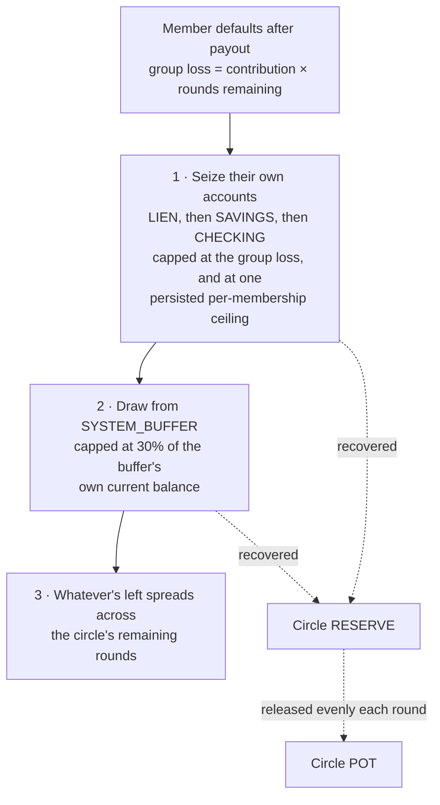
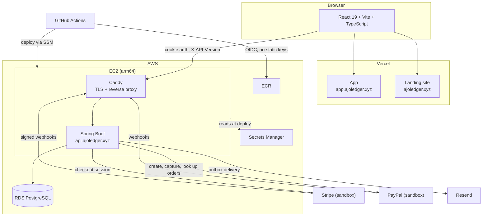

# AjoLedger

A platform for rotating savings groups. These are known as Ajo or Esusu in Nigeria, and as Susu, Chama, tandas or ROSCAs elsewhere. Members contribute a fixed amount each round, and the whole pot goes to one member per round until everyone has been paid once.

The core of it is the trust model, which replaces the social pressure these groups normally run on with reputation backed by real money. Underneath it sits a double-entry ledger that's deliberately thin but has to be correct, since the trust model's guarantees only hold if every movement of money balances.

It's live at [app.ajoledger.xyz](https://app.ajoledger.xyz). "Try the demo" on the login page opens a shared read-only account with circles already played out, so you can look around without signing up. There's a [product overview](https://ajoledger.xyz/) and an [engineering write-up](https://ajoledger.xyz/engineering) too.

Stripe and PayPal both run in sandbox mode only. No real money moves, and [here's why](#payments-are-sandbox-only).

- **[The trust model](#the-trust-model)** is the point. Reputation decides payout order, and real money held in each member's `LIEN` backs it, so a default gets covered without billing anyone else in the group.
- **[The ledger](#the-ledger)** is the foundation it depends on. Double-entry in hand-written SQL, with row locks against concurrent double-spends and Postgres triggers that refuse unbalanced or edited entries.

## The problem

Once a member receives their payout, nothing stops them leaving before they've contributed to the rounds that follow. In person this is handled socially, since everyone in the group knows each other. Online, between strangers, there's nothing to fall back on.

Two obvious fixes don't hold up.

**Put unproven members last in the rotation.** This helps in a large group and fails in a small one. In a two-person circle someone has to go first, and no ordering changes that.

**Give people a trust score.** A score can't absorb a loss. If a well-rated member defaults, there's still nothing to claw back. Reputation only means something financially if there's money behind it.

So the model does both, with money attached: reputation decides who gets the early slots, and real funds cover the exposure.

## The trust model

### Accounts

Each member has `SAVINGS`, `CHECKING` and `LIEN`. Each circle has a `POT` and a `RESERVE`. There's one platform-wide `SYSTEM_BUFFER`.

`LIEN` is where most of the design sits. An earlier version had two separate ideas, a "personal reserve" built from past payouts and a "collateral hold" posted up front. They're the same money doing the same job at different times, so they became one account.

It grows on every payout a member receives, not when a circle completes, so if they default later the balance is already there. It pools across circles, so what someone banked last time backs their standing next time. And it's never locked all at once: a floor holds back what their remaining rounds still expose the group to, and anything above that floor can be withdrawn now.

### Joining costs 10%

Every join moves 10% of the contribution amount from `SAVINGS` into the member's own `LIEN`, halved for invite-only circles. It's atomic with the join, so if someone can't cover the contribution and the hold together, the whole join rolls back.

This is the member's own money, locked, not a fee. It comes back when the membership ends.

### Collateral

```
Potential group loss = contribution amount × (total rounds − payout position)
Required collateral  = max(0, potential group loss − member's banked LIEN balance)
```

A member paid in position P of N rounds still owes a contribution for each of the `N − P` rounds after their own. That's what the group loses if they vanish, and it's what the formula sizes against. Position 1 carries the most exposure. The last position needs nothing, since every round including theirs is already funded by the time they're paid.

The useful consequence: a new member either takes a late slot for free or posts cash for an early one, while an established member with enough banked `LIEN` takes an early slot with no new cash at all. The deposit shrinks toward zero as money-backed trust builds, so reputation and collateral end up being one mechanism instead of two.

### Reputation and position

Positions are assigned when the circle locks, not as people join, so everyone is scored against the same field.

```
successRate       = (successes + prior) / (successes + prior + penalizedFailures + prior)
lienCoverageRatio = min(1, LIEN balance / (contribution amount × (total rounds − 1)))
reputationScore   = w × successRate + (1 − w) × lienCoverageRatio
```

Successes and failures are lifetime counts across every circle a member has been in. A default counts triple a withdrawal, since a default costs the group real money and a withdrawal doesn't. The `prior` term is Laplace smoothing, which keeps someone with no history at a neutral 0.5 instead of an undefined ratio or one that swings on a single data point. The coverage ratio reuses the collateral formula's worst case at position 1 as its denominator.

Highest score gets position 1. Ties break by join order so the sort is deterministic. The early slot is the one people want, so it's the natural thing to give to proven reliability, and it lines up with the collateral math anyway.

Members can see their score and a preview of the position it would currently give them. That preview recomputes on every request, so it moves as people join and can drift from the real position once the circle locks.

### The payout skim

The slice withheld into `LIEN` is sized to what the recipient still needs:

```
neededTopUp = max(0, potential group loss − current LIEN balance)
lienShare   = min(neededTopUp, gross payout × 0.30)
```

Worst case, a recipient keeps 68% of their payout in cash (30% to lien, 2% buffer fee). Someone who has already banked enough gets skimmed nothing beyond the fee.

### The withdrawal floor

```
withdrawal floor = contribution amount × (total rounds − current round + 1)
```

This applies to any active membership in a locked circle, paid out or not. The uniformity is the point. `LIEN` is what justifies an early position at lock time. If the floor only applied after payout, a member could top up right before lock to win an early slot, withdraw it all before being paid, and leave the group backed by nothing. The floor has to hold from the moment the money buys standing, not from the moment risk shows up.

### When someone defaults



Two parts of this are worth calling out.

**Step 3 never bills anyone.** I considered charging the shortfall to the remaining members and dropped it. A member who can't afford a surprise assessment defaults too, which is the correlated failure the whole model exists to avoid. Instead the unrecovered amount just means every remaining round pays out a bit less. Nothing is ever debited from an innocent member.

**Recovered money goes to the circle's `RESERVE`, not the pot.** The waterfall seizes a buyout of the defaulter's whole remaining obligation, not one round's shortfall, so paying it straight into the pot would hand a windfall to whoever's payout came next. The reserve releases in even shares across the rounds that are left. Each release recalculates from the reserve's live balance and the rounds still ahead, so a second default folds into the same schedule, and the last round empties the reserve exactly.

Step 1 takes `LIEN` first, since that's the collateral posted against exactly this loss. Order matters here because a `DEFAULTED` membership is no longer active, so its withdrawal floor drops to zero. If `SAVINGS` went first, any collateral left over would be withdrawable the moment the default posted, while the member's ordinary funds had already been taken in its place.

Step 1 also has a ceiling. Every locked membership carries a persisted `remainingCeiling`, a single budget across all three accounts, checked and decremented once by the total seized, with a `CHECK (remaining_ceiling >= 0)` constraint behind it. The seizure and the decrement share a transaction. A bug in the group-loss calculation can under-seize, but it can't take more than was ever owed.

### Leaving before being paid

A member who misses a contribution before reaching their own payout is withdrawn, not defaulted. There's no group loss to seize against, since they haven't taken anything from the pot yet.

They did lose something, though. Earlier contributions already funded someone else's payout with nothing coming back. So at circle completion, leftover `RESERVE` sweeps into the `POT`, the buffer takes its cut, and the remainder splits across every withdrawn member weighted by how many rounds they actually paid into.

This doesn't make them whole, deliberately. Money that already funded a payout is gone, and settlement only hands out what the circle itself still holds. There's no draw on the shared buffer for this.

### Chargebacks

A chargeback gives no warning. The cardholder's bank pulls the money the moment the dispute opens, and the platform finds out afterwards through a webhook.

So on `charge.dispute.created` the member's accounts freeze. `SAVINGS` and `LIEN` sweep into `CHECKING` and all three lock, whatever the dispute's eventual outcome. Circulating a contribution funded by clawed-back money makes no sense, so a frozen member can't fund their next round, and the existing missed-contribution handling takes it from there.

The platform doesn't absorb the loss. It's a risk the model already prices at the circle level, so it recovers through the same order as any default. The sweep has already consolidated everything into `CHECKING`, so step 1 seizes the whole frozen balance from that one account.

## Worked example

Chinedu has $150 in `LIEN` from previous circles. He joins a $100-per-round circle and his score gets him an early position without posting new cash, since his balance already covers the requirement.

He defaults with 3 rounds left after his payout, having already withdrawn the cash from it. Group loss is $300.

| Step | Source | Covers |
|---|---|---|
| 1 | Chinedu's `LIEN` | $150 |
| 1 | Chinedu's `SAVINGS` and `CHECKING` | $0, already emptied |
| 2 | `SYSTEM_BUFFER` | $150 |
| 3 | Remaining members | $0 |

The $300 lands in the circle's `RESERVE` and releases across the remaining rounds. Nobody else is worse off and nobody is asked for anything.

Compare that with two brand-new members in a two-person circle. No history, no `LIEN`, and ordering can't help because someone goes first. Whoever takes the early slot posts full collateral in cash. The other takes the safe late slot and posts nothing.

## Architecture



The backend is a modular monolith packaged by feature, not by layer. Each folder holds its own entity, controller, service, repository and DTOs.

```
com.ajoledger.backend/
├── system/      cross-cutting config, security, CORS, properties
├── auth/        JWT issuance and validation, login, OAuth linking
├── user/        identity, kept separate from auth
├── account/     account types and balances
├── ledger/      the ledger core and the hash chain
├── circle/      circles, memberships, rounds, trust calculations, waterfall
├── funding/     Stripe and PayPal deposits, webhooks, reconciliation
├── scheduler/   round, enrollment and email outbox jobs
├── email/       the outbox and its Resend and console transports
├── demo/        seeds the read-only demo account through the real flows
└── devtools/    dev-only transition forcing, never on in production
```

Circle sizing sits behind a `CircleSizingPolicy` abstract class, so the collateral formula, the waterfall and the schedulers never depend on a fixed-size assumption. There are two variants, `FixedSizeCircleSizingPolicy` and `OpenEnrollmentCircleSizingPolicy`, differing only in when enrollment closes: by member count, or by deadline. Invite gating didn't need a third one, since who's allowed in is a separate question from when enrollment closes.

## The ledger

### JPA for state, raw SQL for money

Circles, memberships and profiles go through Spring Data JPA. The ledger doesn't. It's written with `JdbcTemplate`.

`@Transactional` on a JPA call does give you a real database transaction, but Hibernate decides which SQL runs and when. Entities sit dirty in memory until a flush, and flush timing depends on flush mode and commit, not on the moment you called save. That's enough indirection that I couldn't point at a row and say it's locked, at this isolation level, right here. For stopping a concurrent double-spend that's the only question that matters, so the ledger drops to SQL. Full reasoning in [ADR 0004](docs/adrs/0004-jpa-jdbc-persistence-split.md).

### Two legs per transaction

One `transaction` header row plus exactly two `ledger_entry` legs, one account per leg, each debited or credited.

Events touching more than two accounts aren't one bigger transaction. A payout touches the pot, the recipient's `SAVINGS`, the `SYSTEM_BUFFER` and sometimes their `LIEN`, and it's written as several two-leg transactions grouped under one `LedgerOperation` so they're queryable together. More than two legs is perfectly valid double-entry, and the database constraint accepts any leg count. I picked two so "source account" and "destination account" stay unambiguous for every transaction type, with no special-casing needed to read one back. [ADR 0007](docs/adrs/0007-ledger-transaction-leg-arity.md) covers what that cost.

### The write path

`LedgerService.postLedgerTransaction` locks every account the legs touch with `SELECT ... FOR UPDATE`, in a deterministic order so concurrent writes can't deadlock against each other. It checks the debit account has the balance, then writes the header and both legs together and adjusts each account's cached balance.

Grouped operations go through `postLedgerOperation`, which opens one `TransactionTemplate.execute` boundary and passes the operation id into a callback. Nested `execute` calls join the same physical transaction under `REQUIRED` propagation, so everything commits or rolls back together without an `@Transactional` anywhere in the path.

### The database enforces balance

A deferred constraint trigger checks at commit time that every transaction's legs sum to zero and that there are at least two:

```sql
IF net <> 0 OR leg_count < 2 THEN
    RAISE EXCEPTION 'Unbalanced or malformed ledger transaction %', NEW.transaction_id;
END IF;
```

The books balancing isn't something the application has to get right. Postgres refuses the write. Other triggers reject UPDATE and DELETE on the ledger tables entirely, so corrections go through new offsetting entries.

### How it's tested

`LedgerIntegrationTest` releases two transfers of the same full balance from one account at the same moment, held behind a latch, and asserts that exactly one succeeds. `LedgerPropertyTest` uses jqwik to generate random transfer sequences against real Postgres and checks that debits always equal credits, no balance goes negative, an idempotent replay never changes a balance, and the waterfall never seizes past a membership's ceiling.

### Idempotency

Every money-moving write carries an idempotency key, so a retry replays the original result instead of processing twice.

Webhooks needed something different. A webhook's identity is Stripe's event id, not a key the caller chose, and a redelivery isn't a conflicting request, it's the same event arriving again. [ADR 0009](docs/adrs/0009-webhook-idempotency-and-reconciliation.md) has that, plus the hourly reconciliation job that catches payments Stripe thinks succeeded but which never reached the ledger.

PayPal is harder, because my server calls capture itself, so both the webhook and the browser return path move money. [ADR 0011](docs/adrs/0011-paypal-orders-integration.md) covers how capture stays single-shot and how orders reconcile without a list API.

### Tamper-evident history

Append-only triggers stop ordinary UPDATE and DELETE, but they don't prove nobody bypassed them. So every ledger row gets hashed into an append-only chain: table name, position, previous hash, and the row's own content. Verification walks the chain, refetches each row's current content, recomputes the hash and compares. A mismatch means the row changed after sealing. A broken link means one was removed or reordered.

This started as a synchronous trigger hashing on every INSERT, which capped ledger throughput at roughly 500 to 1,200 tps no matter the concurrency, because every insert across all three tables serialized on one lock. Moving it to a scheduled batch job removed that cost. The trade is that tamper evidence now lags by the sealing interval. [ADR 0010](docs/adrs/0010-ledger-hash-chain-audit-trail.md) has the alternatives.

The chain proves the ledger is consistent with itself, and that's all. The rows and their hashes live in the same database under the same authority, so anyone who can disable the triggers can rewrite a row and recompute every hash after it, and verification will pass. Closing that gap takes external anchoring: periodically publishing the chain's tip hash somewhere this system's own deploy rights can't reach, so rewritten history no longer matches a tip that was already witnessed. That part isn't built yet.

## Supporting features

**API.** Versioned by an `X-API-Version` header, so a resource keeps one URL across versions. Money is `BigDecimal` everywhere, and entities are never serialized directly. [ADR 0001](docs/adrs/0001-api-versioning-strategy.md).

**Auth.** Tokens live in httpOnly cookies and refresh tokens rotate on every use. Presenting an already-rotated one revokes the whole login. Google sign-in only links to an existing account, and only when Google asserts the email is verified. [ADR 0006](docs/adrs/0006-auth-identity-security-model.md).

**Email.** Queued in an outbox table inside the transaction that triggers it, then sent through Resend by a background job, so a provider outage can't roll back money that already moved. [ADR 0012](docs/adrs/0012-transactional-email-outbox.md).

**Demo account.** One shared account whose session the server limits to `GET` requests. Its history comes from running the real circle flows at startup, not from inserted rows. [ADR 0013](docs/adrs/0013-read-only-demo-account.md).

## Stack

**Backend.** Java 21, Spring Boot 4.1, Spring Security, Spring Web MVC. JPA for state, `JdbcTemplate` for the ledger. PostgreSQL 16 with Flyway. JJWT, zxcvbn for password strength, Google API client, stripe-java, PayPal's server SDK, Resend for email.

**Frontend.** React 19 with the React Compiler, Vite, TypeScript, TanStack Query, React Router, Tailwind v4, shadcn/ui. The landing site in `landing/` is a separate Vite app on the same stack.

**Testing.** JUnit 5 with Testcontainers against real Postgres, plus jqwik property tests for ledger and waterfall invariants.

**Infrastructure.** Docker, Terraform, GitHub Actions, AWS (EC2, ECR, RDS, Secrets Manager, SSM, IAM via OIDC), Caddy, Vercel.

## Running it

You'll need JDK 21, Node 20+, and Docker.

```bash
git clone git@github.com:Kelex15/AjoLedger.git
cd AjoLedger
docker compose up -d
```

Compose defaults to database, user and password `ajoledger` on port 5433, which is what the backend expects.

```bash
cd backend
cp .env.example .env    # set JWT_SECRET plus your Stripe and PayPal sandbox keys
./mvnw spring-boot:run
```

Runs on `http://localhost:8081`, and Flyway applies the migrations on first boot. `JWT_SECRET`, `STRIPE_API_KEY` and the PayPal credentials have no defaults on purpose. A committed fallback secret is a real vulnerability, so the app won't start without them. Email goes to the console locally, so verification links show up in the backend logs.

```bash
cd frontend
cp .env.example .env    # VITE_API_BASE_URL, VITE_GOOGLE_CLIENT_ID
npm install
npm run dev
```

Runs on `http://localhost:3000`. The landing site runs the same way from `landing/`, on port 3001, and needs no env file.

```bash
cd backend && ./mvnw test
```

Testcontainers starts a real Postgres per run, so Docker has to be up. The integration tests cover concurrent writes to the same account, which is where the locking actually gets exercised.

## Deployment

Terraform in `terraform/` provisions the AWS side and is applied by hand. On each push to `main` that touches the backend, GitHub Actions runs the tests, builds an arm64 image tagged with the commit SHA, and redeploys over SSM. AWS auth is OIDC, so there's no SSH port open and no long-lived key anywhere. The instance health-checks the new container through Caddy and restores the previous image if the check fails. The app and the landing site deploy to Vercel.

### Payments are sandbox only

Stripe and PayPal both run in sandbox mode. No live credentials exist in this project and none will.

Real money movement means money transmission licensing, which is well beyond what a portfolio project can take on, and running real payments without it would breach the processor's terms. Sandbox still covers everything interesting on the engineering side: hosted checkout, webhook signature verification, at-least-once delivery handled idempotently, out-of-order events, and reconciliation for deliveries that never arrive.

## Tradeoffs and gaps

**The buffer can run dry.** The 30% draw cap stops one default emptying the pool, but a broad shock hitting many circles at once is a different problem and I haven't modelled it.

**Collateral works against the product's purpose.** ROSCAs exist to serve people without spare capital, and asking new members for collateral pulls the other way. The join-time hold is small and recoverable, and the free late-position path exists, but this isn't settled. It needs user testing, not more reasoning.

**Constants are placeholders.** The reputation weight `w = 0.5`, the 3× default multiplier, the 30% skim cap, the 2% buffer fee and the 30% draw cap are plausible, not tuned.

**Tamper evidence lags**, by design, per the throughput trade above.

**One circle at a time.** Members can only hold one active membership. That closes a gaming path where someone accrues `LIEN` across many small circles and then exploits a large one, and it makes `LIEN` pooling safe to reason about. It's also a real product limitation.

**No refunds.** A member who deposits the wrong amount withdraws instead. A reversal path means another way money flows backwards through the ledger, and withdrawal already covers it.

**Withdrawals never leave the ledger.** Deposits come in through real sandbox rails, but withdrawals only move money between ledger accounts. Stripe has no payout path here either, and PayPal Payouts is its own API with separate onboarding, so both will get done together.

**One backend instance is assumed.** Scheduled jobs, the email outbox included, rely on runs never overlapping, and the login lockout counter isn't safe to increment from several instances at once. Scaling out would need a claim step such as `FOR UPDATE SKIP LOCKED` for the jobs and a shared store for the counter.

**2FA is deferred.** ADR 0006 records it as a gap, not an oversight.

**Not built yet.** k6 load testing on the ledger write path, CloudWatch monitoring with a post-deploy smoke test, and a frontend test suite. Frontend CI is lint and build only for now.

## Docs

- [`backend/docs/design/v3.md`](backend/docs/design/v3.md) is the current trust model in full, including open questions. `v1.md` and `v2.md` stay as the record of how it changed and why, never edited once superseded.
- [`docs/adrs/`](docs/adrs/) holds the architecture decisions, with the alternatives I actually weighed.
- [`backend/docs/CHALLENGES.md`](backend/docs/CHALLENGES.md) logs the bugs and rework honestly.
- [`backend/docs/LEARNING.md`](backend/docs/LEARNING.md) tracks concepts worth going deeper on.
